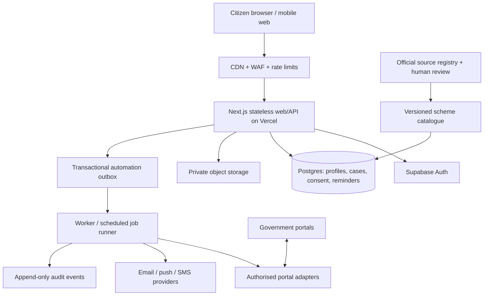

# JanaSetu AI — target production architecture

## Architecture decision
The current Next.js application remains the public web edge and citizen experience. Citizen identity, durable records, consent, workflow state and private documents move to a managed PostgreSQL/Auth/Storage backend. Scheme ingestion and review remain a separate trusted publishing pipeline. Government portals are external systems and are never treated as if they expose a universal submission API.

### Target topology

## Data boundaries
- Browser: ephemeral UI state only. The current application still persists profiles, drafts, reminders and document metadata in localStorage; this is a known pre-backend limitation, not durable or cross-device storage.
- Auth: Supabase Auth; user IDs are the ownership key. Authorization must be checked server-side on every record and action.
- Database: Postgres with RLS on every exposed table. Citizens may read only their own records and published scheme versions. Sensitive writes and workflow transitions are server-mediated.
- Files: private object bucket, random object keys, 12 MiB hard limit and MIME allowlist. Uploads remain disabled until a malware/content scanning pipeline and retention/deletion controls are operational. Never request Aadhaar, bank credentials, OTPs or passwords.
- Scheme catalogue: immutable versions, source provenance, freshness, content checksum and independent source/rule approvals. Budget allocations and third-party machine-parsed discovery records cannot be promoted to eligibility rules without evidence and review.
- Automation: transactional intent/outbox, idempotency keys, explicit purpose consent, per-action confirmation, short-lived authorization and a human-readable result. Never claim a portal submission succeeded without a verified receipt from that portal.
- Audit: record action type, actor, request ID, timestamp and non-sensitive metadata. Do not log profile values, document contents, access tokens, OTPs or full request bodies.

## Approval model
1. Citizen selects a scheme and sees the source, last-checked date, unknown conditions, missing information and likely next steps.
2. Citizen reviews the exact data to be used and grants purpose-specific consent.
3. JanaSetu prepares a draft; this is not a submission.
4. If an authorised portal adapter exists, show the destination domain, fields, files, legal declarations and any fee before action.
5. Ask for an explicit, time-bounded confirmation immediately before the consequential action. OTPs, CAPTCHA, identity proofing, declarations, payment and final submit remain citizen-controlled unless the portal provides a lawful delegated API and its terms expressly permit the integration.
6. Verify an external receipt/reference number and status. If verification is unavailable, label the outcome unverified and direct the citizen to the official portal.
7. Provide a revocation path and audit history.

## Capacity and scaling
The current Vercel + localStorage prototype is not engineered or load-tested for millions of concurrent users. A free-tier deployment cannot responsibly guarantee that capacity. The architecture is designed to scale horizontally, but actual capacity depends on provisioned database compute, connection pooling, storage, queue throughput, provider quotas, regional distribution and measured traffic.

Before making a million-user claim:
- Define workload targets (registered users, peak requests/second, concurrent sessions, read/write ratio, p95/p99 latency and availability objective).
- Keep Next.js handlers stateless; cache only public/versioned scheme data at the CDN.
- Use database connection pooling, bounded query timeouts, indexes and cursor pagination. Avoid per-request full-catalogue scans.
- Move long-running jobs to a durable queue with retries, dead-letter handling, idempotency and per-user quotas.
- Rate-limit by account, IP and action; protect expensive search/AI/portal adapters.
- Run realistic k6/Artillery tests with synthetic accounts and no production PII; test database saturation and recovery.
- Add observability for request latency, error rates, queue lag, database pool pressure, storage errors and external provider failures.
- Provision paid capacity only after measured need and a budget approval. Do not advertise a free-tier service as supporting millions of simultaneous users.

## Free-tier policy
Use free plans for development and a controlled pilot only. Do not promise a free production service at million-user scale. A dedicated JanaSetu project now exists in the Projects organization in Mumbai; CareerOS remains separate and unchanged. The quoted project-creation cost was $0/month. Any later paid capacity or add-ons require separate budget approval.

## Migration status
- Citizen-data schema is tracked in `supabase/migrations/20261109130314_create_citizen_data_foundation.sql` and applied to the dedicated JanaSetu project.
- Includes profiles, source registry, immutable scheme versions, reviewer approvals, application cases/events, document metadata, purpose consents, reminders, automation runs and audit events.
- RLS is enabled on every public table. Citizen writes to cases, document metadata, automation and audit are server-mediated. Storage is private; browser uploads are intentionally not enabled before scanning exists.
- The schema and `20261109130423_harden_api_grants_and_index_foreign_keys.sql` are applied remotely. All 12 public tables have RLS enabled; explicit grants revoke browser access to privileged tables and restrict citizen writes. Initial privilege probes confirmed anon cannot read citizen data or truncate tables, authenticated users cannot mutate cases/automation, and `service_role` retains server access. Two-user isolation tests, Auth integration, malware scanning and end-to-end workflow tests remain release gates.

## Immediate implementation sequence
1. Dedicated project created and schema applied; complete two-user RLS isolation tests using unrelated test accounts plus anon/service contexts.
2. Add Supabase SSR Auth, email verification, recovery, session rotation and account deletion.
4. Replace localStorage as source of truth with authenticated server persistence; retain explicit encrypted export/import for user portability.
5. Add consent ledger, append-only case events, idempotent automation outbox and reminder scheduler.
6. Add safe private file upload, scanning/quarantine, retention and deletion workflow.
7. Add independently reviewed scheme publication and freshness workflows.
8. Add only permitted portal integrations, with confirmation gates and receipt verification.
9. Run security, privacy, accessibility, disaster-recovery and load tests before expanding public access.

## Government integration authorization boundary

The government integration plan is documented in `docs/government-integration-access-plan.md`. Do not scrape or automate myScheme without express written authorization; its published Terms of Use prohibit bots/scrapers absent written permission. API Setu consumer access, individual API subscriptions, publisher approvals and DigiLocker requester onboarding are separate requirements. Each department/scheme needs a reviewed adapter manifest and explicit production approval. No portal submission adapter is currently approved.

## Consent-gated automation execution

The dedicated backend now uses Supabase Queues (`pgmq`) and Cron (`pg_cron`). The `janasetu_automation` queue is durable; a database cron job invokes the queue processor once per minute. The worker is database-only and does not require an external service-role key in the web application.

The citizen lifecycle is:
1. A citizen requests an application case. The database RPC accepts only a published, independently approved scheme version with at least two distinct source-accuracy and two distinct eligibility-rule approvals.
2. The citizen records purpose-specific consent with a policy version and scope.
3. The citizen requests a specific automation action. The request is idempotent and remains `awaiting_confirmation`.
4. The citizen explicitly confirms the exact run. Only then is a queue message created.
5. The worker currently processes internal document-checklist preparation and in-app reminder scheduling.
6. External portal actions are rejected until a production-approved adapter exists and is implemented. The consent scope must match the exact destination URL and scheme version; a separate confirmation is still required.

The worker is not a general-purpose browser bot. It cannot bypass OTP/CAPTCHA or government access controls. See `docs/government-integration-access-plan.md`.

Current remote state: 14 public tables, all with RLS; 0 published schemes and 0 independently approved versions. The queue and scheduler are operational but have no eligible production scheme work to process yet.
